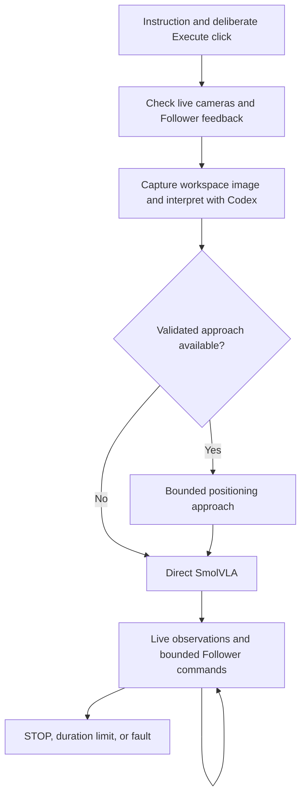

# ElRobot Mission Control

A local workspace for teaching and controlling an eight-joint ElRobot with camera observations, natural-language instructions, and a trained SmolVLA policy.

This project extends [Manas Arumalla's norma-robot repository](https://github.com/Manas-arumalla/norma-robot). Our additions focus on Mission Control, local demonstration recording and training, camera calibration, six-point robot teaching, Codex image interpretation, and continuous SmolVLA execution.

## Our additions

- **Mission Control** with Execute/STOP, two camera previews, eight-joint telemetry, action counts, and troubleshooting logs.
- **Codex vision** receives a captured workspace image and the instruction, then returns an approximate object bounding box. A constrained OpenCV blue-block detector provides an explicitly labelled fallback.
- **Persistent SmolVLA execution** reuses the existing policy runner and retains the loaded checkpoint across actions and runs.
- **Fresh model observations** combine the selected workspace and wrist cameras with measured Follower feedback from one synchronized Station snapshot. The model camera order matches our recordings: workspace first, wrist second.
- **Separate calibration page** supports four clicked image references with measured tabletop X/Y coordinates, saved homography, and six taught joint configurations.
- **Optional positioning** uses validated teaching or robot alignment when an approach can be planned. Missing calibration, invalid alignment, an unsuitable starting pose, or a failed approach plan during preflight selects direct VLA using the same Execute click.
- **Episode Lab** records teleoperated demonstrations, exports Parquet files, trains a local checkpoint, and previews predictions.
- **MediaPipe hand overlays and browser speech** provide visual and spoken warnings with repetition limits. Hand alerts are warning-only.

## Execution flow



Codex localizes the requested object during preparation. SmolVLA predicts joint actions from current images, joint positions, and the task instruction. Direct VLA uses those observations without tabletop positioning.

Calibration and planning fallback happens before Follower preparation. Once movement preparation begins, camera failures, communication errors, motor faults, or invalid active positioning data stop the run. A new run requires another Execute click.

## Local setup

Use the repository's existing SmolVLA environment and generated Station protocol modules. The launch commands below assume these and the local Station binary are available.

| Component | Local setting |
| --- | --- |
| Station API | `localhost:8888` |
| Follower controller | `5B8E113018` |
| Motors | `1,2,3,4,5,6,7,8` |
| Mission Control | `http://127.0.0.1:8892` |
| Episode Lab | `http://127.0.0.1:8891` |
| Calibration | `http://127.0.0.1:8894/calibration` |

Hardware settings and the deployed checkpoint are defined in [Mission Control configuration](local/mission_control/config.py). Camera selection is saved locally. Calibration files describe a particular physical setup and must be checked before reuse on another robot or camera view.

### Start Station

From the repository root, with the controllers and cameras connected:

```bash
./runtime/station --config local/station.yaml \
  --normfs-base-folder runtime/station_data --tcp --web
```

The prebuilt binary is a local dependency. Station source and build instructions are available in [software/station/bin/station](software/station/bin/station/README.md).

### Open Mission Control

In another terminal, from the repository root:

```bash
software/ai/smolvla_py/.venv/bin/python -m local.mission_control --port 8892
```

Open `http://127.0.0.1:8892`. Select the camera showing the tabletop, confirm both previews and all eight Follower readings are live, enter an instruction such as `Pick up the blue block`, and click **Execute**.

**STOP** cancels subsequent software motor commands and leaves torque unchanged. It is distinct from a physical emergency stop. Autonomous motion targets only the Follower and requires Leader-to-Follower mirroring to be off.

For hand overlays, install the local detector dependencies and model once:

```bash
bash local/mission_control/setup_hands.sh
```

Use **Test voice** in the browser to enable and check spoken warnings.

### Optional camera calibration and robot teaching

```bash
software/ai/smolvla_py/.venv/bin/python local/table_calibration.py --port 8894
```

Open `http://127.0.0.1:8894/calibration`.

1. Capture the tabletop view and click four reference points.
2. Enter their measured tabletop X/Y coordinates in millimetres and save the homography.
3. Position the gripper above six reachable table locations at the same measured height, orientation, and gripper opening. Save each location's measured X/Y and actual eight-joint feedback.
4. Review and physically validate the interpolated approach before enabling it.

Homography converts pixels to table X/Y. Teaching provides joint targets for an optional approach inside the taught region. Interpolation does not independently measure live gripper height or guarantee collision clearance. Keep the camera, robot, and table references fixed.

Mission Control can use direct VLA when the optional setup cannot provide an approach. Grasp performance depends on how closely the current scene and arm state match the demonstrations.

### Record demonstrations

```bash
software/ai/smolvla_py/.venv/bin/python local/episode_dashboard.py
```

Open `http://127.0.0.1:8891`. Use Station teleoperation to perform the task, start a recording, then finish and export it. Five successful exports enable the dashboard's initial training workflow. Additional demonstrations can be recorded.

### Fine-tune a separate candidate

The following example uses our five exported recordings and continues from the initial local checkpoint. Run training while inference is stopped to free GPU memory.

```bash
cd software/ai/smolvla_py
.venv/bin/python scripts/train.py \
  --base-checkpoint checkpoints/block-local-20261122-004545/final \
  --parquets ../../../datasets/elrobot-local/episode_{002,004,005,006,007}.parquet \
  --steps 300 --batch-size 1 --num-workers 0 --seed 17 \
  --lr 3e-5 --save-every 200 \
  --output "checkpoints/block-local-refine-$(date +%Y%m%d-%H%M%S)"
```

The result is saved under the new output directory's `final/` folder. Compare candidates on fresh pickups before changing the configured deployment checkpoint. Repeating the same five demonstrations does not establish robustness across new starting poses, objects, or camera views.

## Repository guide

| Path | Purpose |
| --- | --- |
| `local/mission_control/` | Our UI, execution backend, Codex interpretation, perception, model-input assembly, and positioning integration |
| `local/table_calibration.py` | Separate camera calibration and six-pose teaching page |
| `local/episode_dashboard.py` | Local recording, export, training, and preview dashboard |
| `local/station.yaml` | Station configuration for this setup |
| `local/calibration/` | Setup-specific saved camera and robot teaching data |
| `software/ai/smolvla_py/` | SmolVLA model, dataset reader, training script, and reused policy runner |
| `software/station/` | Inherited Station application, clients, and shared interfaces, with our disconnected-camera registry fix |
| `software/drivers/` | Device drivers and inference data formats |
| `hardware/` | Inherited robot models, hardware designs, and hardware documentation |
| `claude-supervisor/` | Inherited Claude-based experiments and their original documentation |

See the [Mission Control guide](local/mission_control/README.md) for detailed configuration and troubleshooting, the [SmolVLA guide](software/ai/smolvla_py/README.md) for model code, and the [ElRobot hardware guide](hardware/elrobot/README.md) for the arm.

## Current scope

The demonstration task is picking the blue object represented in our local recordings. Codex detection confidence and offline prediction error do not measure successful grasp rate. The project requires supervised hardware evaluation. Hand monitoring is a prototype warning feature, and software STOP depends on the control and communication path.

Datasets, checkpoint weights, virtual environments, downloaded detector assets, and runtime recordings are excluded from Git. Supply or generate them locally. The saved JSON calibration examples are specific to this setup.

## Credits and licensing

Our work builds on [Manas Arumalla's norma-robot repository](https://github.com/Manas-arumalla/norma-robot), which includes NormaCore/ElRobot infrastructure, SmolVLA integration, and earlier Claude-supervisor experiments. Their original source history, copyright notices, and component documentation are retained.

This fork presents our ElRobot Mission Control additions. The previous team's hackathon awards and demo claims are part of the upstream project's history and are not claims about our work.

See [LICENSE](LICENSE) and the component-specific license files for applicable terms.
